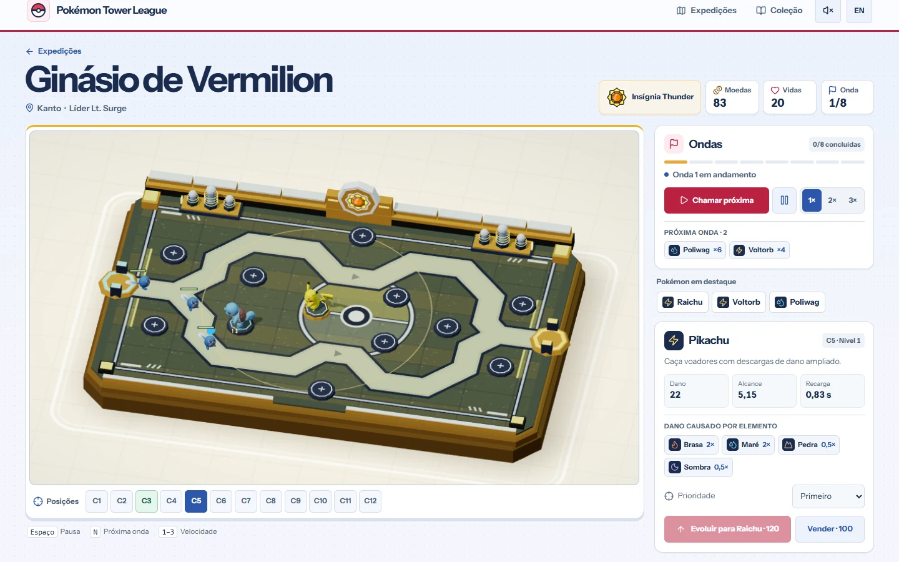
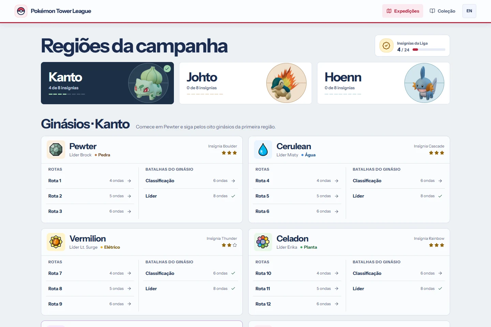

# Pokémon Tower League

**Tower defense 3D de fã, jogável no navegador.** Recrute Pokémon de Kanto, Johto e Hoenn, evolua sua equipe durante a batalha e conquiste as 24 insígnias para disputar o Torneio Final.

[Campanha](#campanha) · [Como jogar](#como-jogar) · [Rodar localmente](#rodar-localmente) · [Desenvolvimento](#desenvolvimento)



## Campanha

As três regiões podem ser iniciadas em qualquer ordem. Em cada trecho, vença três rotas, passe pela classificação e enfrente o líder. A vitória contra o líder concede a insígnia e abre o próximo trecho.

| Região | Pokémon iniciais | Desafios |
| --- | --- | --- |
| Kanto | Charmander, Squirtle e Bulbasaur | 24 rotas, 8 classificações e 8 líderes |
| Johto | Cyndaquil, Totodile e Chikorita | 24 rotas, 8 classificações e 8 líderes |
| Hoenn | Torchic, Mudkip e Treecko | 24 rotas, 8 classificações e 8 líderes |

Cada região oferece oito famílias de Pokémon, com papéis que vão de dano em área a suporte e defesa antiaérea. Os ginásios têm arenas 3D com pisos, insígnias e cenários inspirados em suas especialidades, como piscinas nos de água e geradores nos elétricos. As batalhas de ginásio têm trilhas regionais.

**Torneio Final.** Conquiste as 24 insígnias e defenda duas rotas durante 16 ondas contra equipes das três regiões. Ao todo, são **121 batalhas na campanha**.



## Como jogar

1. **Monte a defesa.** Selecione uma posição no tabuleiro e invista as moedas iniciais em Pokémon. Consulte a prévia da onda para planejar a cobertura e aproveitar fraquezas elementais.
2. **Inicie a onda.** Os Pokémon atacam automaticamente. Derrote inimigos e conclua ondas para ganhar moedas. É possível chamar a próxima onda enquanto a anterior ainda estiver ativa.
3. **Evolua e ajuste sua equipe.** Melhore as torres para liberar evoluções e chegar à habilidade final no nível 3. Troque a prioridade de alvo ou venda uma torre por 70% do investimento.
4. **Conquiste estrelas.** Uma vitória vale pelo menos uma estrela. Com 8 vidas ou mais, você ganha duas. Com 16 ou mais, ganha três. O melhor resultado de cada batalha fica salvo no navegador e ajuda a liberar Pokémon da Coleção.

| Controle | Ação |
| --- | --- |
| Arrastar | Mover a câmera |
| Roda do mouse ou pinça | Aproximar ou afastar |
| `N` | Chamar a próxima onda |
| `Espaço` | Pausar ou retomar |
| `1`, `2`, `3` | Alterar a velocidade |
| `Esc` | Limpar a seleção |

Com o servidor local aberto, você também pode jogar nos mapas clássicos. [Bosque](http://localhost:3000/play) · [Caverna](http://localhost:3000/play/cave) · [Vulcão](http://localhost:3000/play/volcano)

## Rodar localmente

Requer **Node.js 24** e **pnpm 11.25.0**.

```sh
git clone https://github.com/RafaelADSdev/Pokemon-tower.git
cd Pokemon-tower
pnpm install --frozen-lockfile
pnpm dev
```

Abra [localhost:3000](http://localhost:3000). Use um navegador com WebGL 2 para visualizar as arenas em 3D. Parte dos modelos é carregada sob demanda a partir do catálogo remoto, com retratos locais durante o carregamento de uma torre.

## Desenvolvimento

O jogo usa **Next.js, React e TypeScript** na interface, **React Three Fiber e Three.js** para renderizar as arenas e **Howler** para áudio. A simulação de combate usa passos fixos de 1/60 s, com as regras e o estado separados da renderização.

| Para editar | Onde começar |
| --- | --- |
| Regiões, líderes, insígnias e especialidades | [Definições dos ginásios](src/data/campaign/gyms.ts) |
| Ondas e adversários por região | [Ondas da campanha](src/data/campaign/waves.ts) · [Elencos inimigos](src/data/regionEnemies.ts) |
| Pokémon, elencos e vantagens | [Criaturas](src/data/creatures.ts) · [Elencos regionais](src/data/regionalCreatures.ts) · [Elementos](src/data/elements.ts) |
| Tabuleiros e cenários | [Mapas](src/data/maps/) · [Renderização 3D](src/render/) |
| Combate, economia e efeitos de estado | [Motor de partida](src/game/runtime.ts) · [Sistemas](src/game/systems/) |
| Desbloqueios da campanha | [Regras de progresso](src/lib/campaignProgress.ts) |

```sh
pnpm lint
pnpm test
pnpm build
```

Os testes cobrem vitórias nas rotas, nos ginásios e no Torneio Final, além da progressão, das evoluções e das regras de combate. Para abrir a versão compilada, execute `pnpm start` após o build.

`pnpm bench` mede a simulação com 300 inimigos e 11 torres evoluídas. Para medir a renderização no Chrome, use o [script de benchmark](scripts/bench-browser.mjs) com os caminhos de uma instalação auxiliar de `playwright-core` e do executável do navegador.

## Créditos

Projeto de fã independente. Pokémon, seus personagens e seus materiais pertencem aos respectivos titulares. Consulte as origens dos modelos, insígnias e faixas de áudio no [registro de recursos e créditos](ASSETS.md).
